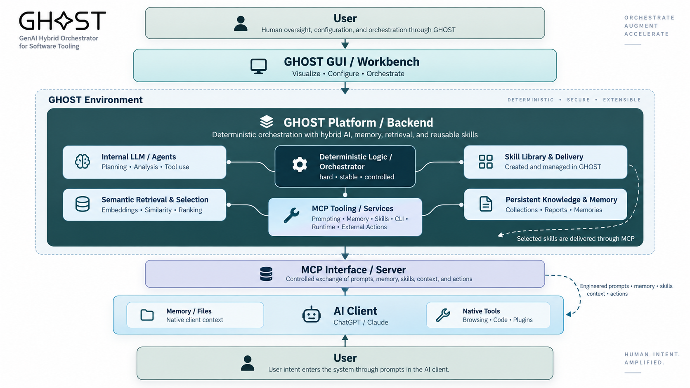
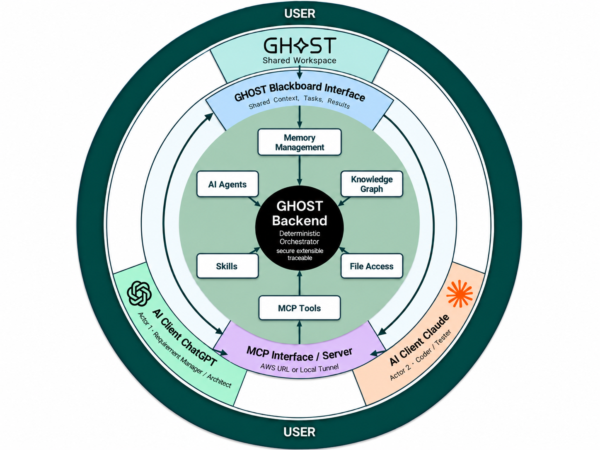
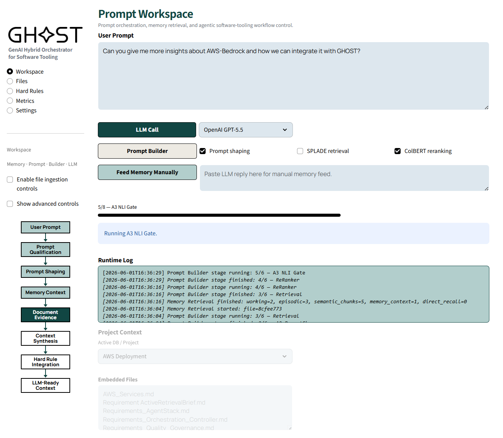
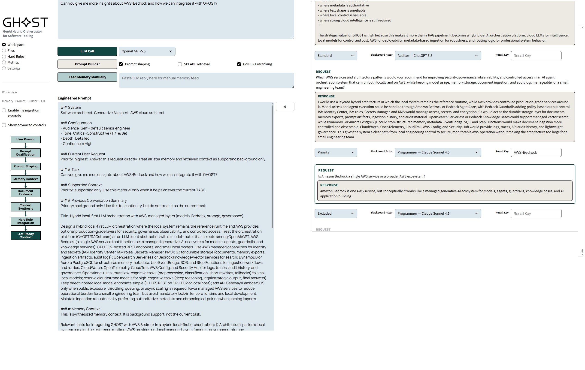
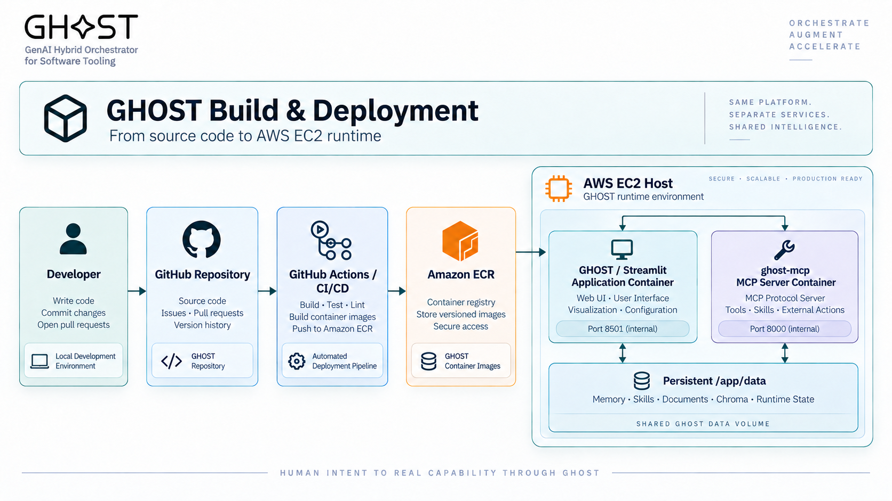
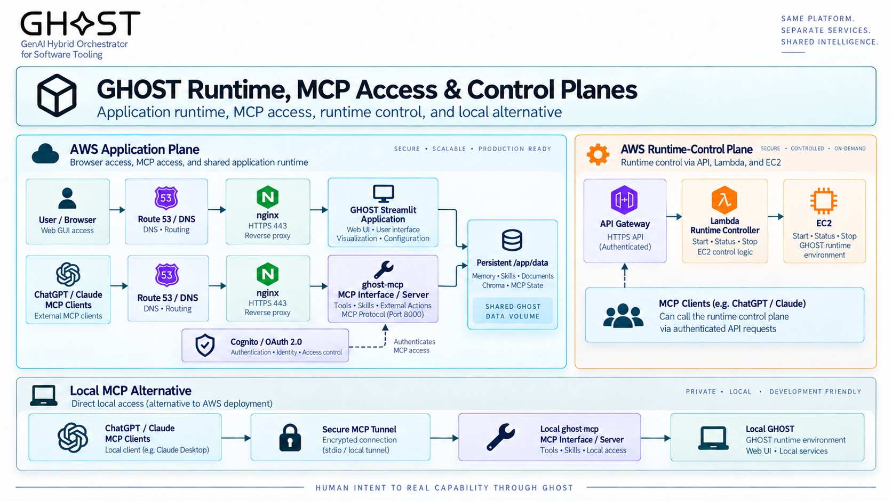

# GHOST — GenAI Hybrid Orchestrator for Software Tooling

GHOST is an **extensible and highly adaptable AI engineering orchestration platform** for software tooling. It connects multiple AI environments, project knowledge, persistent memory, reusable Skills, engineering tools, and deterministic control within one human-steered ecosystem. GHOST is designed for long-running engineering work where context continuity, traceability, governance, and explicit control over what is retrieved, shared, executed, and preserved matter.

## Current GHOST Architecture — Hybrid AI Engineering Platform

<p align="center">
  
</p>

GHOST is designed as a **hybrid AI engineering platform whose components can be used independently or as one integrated system**. It can operate as a standalone environment through its own GUI/Workbench, combining deterministic orchestration with internal LLMs and agents, reusable Skills and tooling, semantic retrieval, and persistent knowledge and memory. At the same time, GHOST can act primarily as an orchestration and control layer for external AI clients such as ChatGPT or Claude through MCP. The user can therefore choose the appropriate operating model for each task: a self-contained GHOST environment, a lightweight orchestration layer that adds controlled memory, context and tools to an external AI client, or a fully integrated workflow in which internal GHOST capabilities and external AI systems cooperate.

This flexibility is central to the architecture. Workloads requiring stronger isolation, governance, deterministic control or private context can remain inside the GHOST environment, while selected tasks can benefit from the broader reasoning, native tooling and continuously evolving capabilities of public AI clients. Rather than duplicating every model-side capability or agent workflow internally, GHOST can selectively delegate work while retaining control over context, memory, rules, tools and orchestration. The result is a human-controlled hybrid system that combines deterministic software infrastructure with both private and external AI capabilities according to the user's security, governance and engineering needs.

## Near-Term GHOST Architecture — Closed-Loop Multi-Client Orchestration

<p align="center">
  
</p>

The near-term GHOST architecture extends the platform from a hybrid AI engineering environment into a **shared orchestration layer for multiple AI actors**. The diagram shows two example clients, but the architecture is not limited to two: each connected client can assume a distinct role, maintain its own working context and ActiveBrief, and contribute to the same GHOST-managed engineering process. In the example, ChatGPT acts as a **Requirements Manager and Architect**, while Claude acts as a **Coder and Tester**. The human user remains the outermost authority and can interact simultaneously through the native AI clients and through the GHOST Workbench. This creates an important control path: instead of relying only on follow-up prompts inside an external AI client, the user can intervene directly through GHOST, inject corrections, change priorities, trigger retrieval, or deterministically instruct an actor to use a particular Skill or context source.

The architecture can be read from the outside inward through five layers. **Layer 1 — User** represents the human authority around the complete system. **Layer 2 — AI Actors** contains connected clients such as ChatGPT, Claude, and additional actors, each with its own role, private context and ActiveBrief. **Layer 3 — Interface & Blackboard** provides the communication boundary between these actors and GHOST. On the external-AI side, the **MCP Interface / Server** exposes GHOST capabilities to the connected clients. On the GHOST side, the corresponding **GHOST Blackboard Interface is implemented as a FastAPI server**, serving the React/TypeScript frontend and acting as the interface between the Workbench, the GHOST Backend, and the MCP environment. It communicates user commands from the frontend to the backend and uses backend services such as Memory Management to construct and maintain the shared Blackboard, preserving actor identity while combining selected knowledge, status, tasks and results in a common workspace.

Two communication paths are deliberately available. When an operation requires GHOST capabilities, the Blackboard Interface routes it through the **GHOST Backend**. For example, if the user wants ChatGPT to receive a particular **Skill** or retrieved **Memory**, GHOST must first locate, validate and prepare that information through its internal tools and then deliver it through MCP. In contrast, when no orchestration, retrieval, persistence or other backend processing is required, the Blackboard Interface and MCP Interface / Server can communicate **directly through a bidirectional WebSocket connection**. This avoids unnecessary backend latency for simple real-time exchange. A correction or piece of information entered in the GHOST Workbench can therefore be transmitted immediately to Claude, while a status value or message received by the MCP Interface from ChatGPT can be exposed directly to the GHOST Blackboard without first passing through the complete orchestration pipeline. The backend remains available whenever deeper processing is needed, while the direct path keeps simple coordination fast and responsive.

Inside this interface boundary, **Layer 4 — GHOST Capabilities** contains the persistent and reusable services supporting the system: Memory Management, AI Agents, Skills, File Access, MCP Tools, and the Knowledge Graph. These capabilities allow GHOST to normalize and persist actor knowledge, perform semantic retrieval, access local engineering information, execute internal AI workflows, and provide reusable capabilities back to connected actors. At the center, **Layer 5 — Deterministic Orchestrator** forms the stabilizing core around which the more fluid AI components operate. It can independently call LLMs and agents, enforce deterministic workflow logic, control tools and context, retrieve memory and knowledge, and decide how internal and external AI capabilities should cooperate.

The architectural objective is to **close the loop**. External AI actors contribute reasoning, coding capabilities and their native tooling from one side, while GHOST can independently evaluate, constrain, enrich and redirect their work from the other. The user can intervene through either environment, and the two interface servers can exchange state directly where appropriate. This provides multiple control paths rather than depending on a single model, prompt chain or user interface, enabling stronger guardrails, evaluation, redundancy and traceability. It also gives the user explicit control over the balance between **privacy, cost and capability**: sensitive or highly governed processing can remain inside the private GHOST environment through direct model access, while other workloads can exploit subscription-based public AI clients and their extensive native tooling. GHOST remains the coordinating authority that determines how these different forms of intelligence, memory and tooling cooperate.

## GHOST Workbench — Visual Overview

<p align="center">
  
  <br/>
  <em>GHOST main workspace: prompt input, model selection, Prompt Builder execution, live pipeline status, runtime logging, and project context.</em>
</p>

<p align="center">
  
  <br/>
  <em>GHOST orchestration view: engineered prompt generation, retrieved and memory context, Blackboard actors, recall keys, and structured prompt assembly.</em>
</p>

The Workbench provides the human-controlled surface of the platform. It exposes prompt construction, retrieval, memory, model and actor selection, execution state, and diagnostics without hiding the surrounding orchestration logic inside a model call.

## AWS Deployment and Future GHOSTOps

GHOST supports both **local and AWS-based operation**. The deployment pipeline follows a conventional CI/CD path from GitHub through GitHub Actions and Amazon ECR to an EC2-hosted runtime. The EC2 environment runs the GHOST application and the `ghost-mcp` service as separate containers while sharing persistent GHOST data.

### Build and Deployment

<p align="center">
  
</p>

Source changes flow through GitHub and GitHub Actions into container images stored in Amazon ECR. The EC2 runtime hosts the GHOST/Streamlit application and `ghost-mcp` as separate Docker services, with persistent state kept outside the container images under `/app/data`.

### Runtime, MCP Access and Control Plane

<p align="center">
  
</p>

At runtime, the architecture separates the **application plane** from the **runtime-control plane**. Browser and MCP traffic reach the running GHOST services through DNS, HTTPS, nginx, and authenticated MCP access with Cognito/OAuth. A separate serverless control path through API Gateway and Lambda can start, stop, and inspect the EC2 runtime independently. The same MCP capabilities can also be exposed from a local GHOST installation through a secure tunnel, allowing the user to choose between cloud-hosted and locally isolated operation.

### Future GHOSTOps

As GHOST develops across different runtime environments and software generations, persistent state must remain portable and compatible. Simply synchronizing or merging local and AWS databases is not sufficient because memory schemas, metadata, Skills, indexes, Knowledge Graph structures, and runtime assumptions can evolve independently. The planned **GHOSTOps** layer addresses this as an operational lifecycle problem rather than a file-copy problem. GHOST state will be captured as versioned, self-consistent snapshots stored in S3 together with manifests describing the GHOST release, runtime, schema versions, checksums, and compatibility requirements.

**GHOSTOps** is envisioned as the next major operational layer after the Blackboard architecture. It will manage snapshot creation, restore, compatibility validation, migration, rollback, and Local↔AWS portability. When an older snapshot is loaded by a newer GHOST release, GHOSTOps can identify incompatibilities and, where possible, deterministically migrate the state—for example by adding newly required metadata, upgrading SQLite schemas, rebuilding derived indexes, or adapting persisted structures without modifying the original snapshot. The long-term goal is that a GHOST environment becomes reproducible and replaceable: the software version, persistent state, and migration path are explicitly known, so a user can move safely between development, release, local, and cloud environments without losing operational integrity.

## Core System Capabilities

### Deterministic Orchestration and Prompt Engineering

GHOST combines deterministic software flow with LLM-based processing instead of delegating the complete workflow to a model. Its central prompt-building path can preprocess user input, shape requests, select and validate context, retrieve project knowledge and memory, apply relevance gates and condensers, and assemble structured model-ready prompts. Deterministic rules remain available for decisions that should be explicit, repeatable, inspectable, or safety-critical.

### Project Knowledge and Hybrid Retrieval

Project documents such as requirements, architecture material, technical documentation, notes, and engineering context can be ingested and retrieved through a hybrid retrieval stack. GHOST supports dense embeddings, SPLADE-based sparse retrieval, weighted fusion, optional reranking, relevance filtering, and context condensation so retrieved evidence can be inspected and deliberately incorporated rather than silently injected.

Relevant implementation areas include `ragstream/ingestion/`, `ragstream/retrieval/`, `data/doc_raw/`, `data/chroma_db/`, and `data/splade_db/`.

### Persistent Multi-Mode Memory

GHOST provides persistent memory as an engineering subsystem rather than relying only on model chat history. Its memory family includes **Episodic Memory**, **Clipboard Memory**, **Collection Memory**, and persistent chat/ActiveBrief workflows. Memory supports exact recall, semantic retrieval, owner-scoped storage, structured metadata, durable `.ragmem` / `.ragmeta.json` records, SQLite indexing, and reusable compressed context for later engineering work.

Relevant implementation areas include `ragstream/memory/`, `data/memory/`, and `data/mcp/memory/`.

### Skills and Reusable Context

GHOST Skills package reusable instructions and domain knowledge that can be discovered, selected, loaded exactly, and delivered to internal workflows or external AI clients. CLI Skills and General Skills are maintained as separate domains, with owner-scoped catalogs, tags, lifecycle handling, and immutable replacement of active Skill versions.

Relevant implementation areas include `ragstream/skills/` and `data/skills/`.

### MCP Integration and External AI Clients

The GHOST MCP layer exposes orchestration capabilities to external AI clients such as ChatGPT and Claude. Authenticated MCP tools provide access to engineered prompts, memory, Skills, CLI execution, runtime control, and other GHOST capabilities while preserving owner isolation and explicit tool boundaries. The same MCP application can run through the AWS deployment or through a secure local tunnel.

Relevant implementation areas include `ragstream/mcp/`, `Dockerfile.mcp`, and `data/mcp/`.

### Controlled CLI and Tool Execution

GHOST can execute controlled machine actions through its CLI layer using local Bash/WSL or AWS SSM-backed execution. Safety profiles, explicit confirmation for dangerous or ambiguous commands, durable asynchronous jobs, and exact result retrieval provide a deterministic boundary around machine-level actions. Additional tools can be exposed through the same controlled orchestration model.

Relevant implementation areas include `ragstream/cli/`, `ragstream/tools/`, and `data/mcp/cli/`.

### Agent Layer

GHOST uses configurable LLM-based agents where semantic interpretation, classification, condensation, or synthesis are useful, while deterministic software remains responsible for the surrounding control flow.

| Agent / Capability | Purpose |
|---|---|
| Prompt Input Cleanup | Normalizes unclear or noisy user input before deeper processing when enabled. |
| Prompt Understanding / Relation Classification | Interprets the request and its relationship to available context or memory. |
| Prompt Shaping | Structures the request into a clearer model-ready task representation. |
| Evidence Relevance Gate | Decides whether retrieved document or memory evidence is useful for the current task. |
| Document Context Condenser | Compresses selected document evidence into coherent context. |
| Memory Context Condenser / Synthesizer | Combines selected memory episodes and semantic memory into compact reusable context. |
| Continuous Memory Brief | Maintains a compact ActiveBrief across a persistent engineering discussion. |

Relevant implementation areas include `ragstream/agents/`, `ragstream/orchestration/`, `ragstream/preprocessing/`, and `data/agents/`.

### Logging, Traceability and Observability

GHOST keeps important orchestration behavior inspectable through structured logging, developer diagnostics, runtime logs, and traceable context construction. Requirements work uses stable identifiers and code-grounded traceability processes to support controlled synchronization between requirements, architecture, implementation, and tests. Metrics and observability continue to expand around retrieval, memory, latency, model usage, and system decisions.

Relevant implementation areas include `ragstream/textforge/`, `data/logs/`, and the requirements/traceability material under `doc/01-Requirements/`.

### Knowledge Graph Direction

The Knowledge Graph is the next structural layer for connecting requirements, architecture, code, tests, memory, and other engineering artifacts through deterministic relationships plus semantic retrieval. The architecture and data model are defined, while the full Knowledge Graph backend remains under development. The intended GraphRAG path combines candidate retrieval with deterministic graph traversal and materialization before model reasoning.

Relevant implementation area: `ragstream/knowledgegraph/`.

## Repository Structure

A shortened view of the current implementation areas:

```text
ragstream/
  agents/             # LLM-based specialist agents
  app/                # GHOST GUI, controller and UI actions
  cli/                # Controlled local/AWS command execution
  config/             # Runtime and prompt configuration
  ingestion/          # Document loading, chunking and embeddings
  knowledgegraph/     # Knowledge Graph foundation
  mcp/                # MCP server, tools and client-facing integration
  memory/             # Persistent memory recording, storage and retrieval
  orchestration/      # Prompt assembly, agent execution and LLM integration
  preprocessing/      # Input preprocessing and relation classification
  retrieval/          # Dense/sparse project retrieval
  skills/             # CLI and General Skill infrastructure
  textforge/          # Structured logging infrastructure
  tools/              # Controlled tool integrations
  utils/              # Shared utilities

data/
  agents/             # JSON-defined agent configurations
  chroma_db/          # Dense document vector stores
  doc_raw/            # Project document sources
  logs/               # Runtime and developer logs
  mcp/                # MCP memory, CLI, prompt and Skill settings
  memory/             # Persistent memory state and vector data
  skills/             # Owner-scoped Skill artifacts
  splade_db/          # Sparse retrieval stores
  tools/              # Persistent tool-specific state

doc/
  01-Requirements/    # Requirements and traceability
  02-Architucture/    # Architecture documentation
  03-Projekt_Status/  # Implementation status and reports
  04-GUI/             # GUI material
  05-Design_Process/  # Detailed design work
  06-PowerPoints/     # Presentation material
  10-Research_Ideas/  # Research and future ideas
  11-Generic_RULES/   # Reusable engineering rules
  12-README_Images/   # Public README graphics

infrastructure/       # AWS/infrastructure definitions
lambda/               # Serverless runtime-control components
tests/                # Automated tests
```

Some internal folder and document names still reflect the earlier project name **RAGstream**. The current project identity is **GHOST**.

## Documentation and Requirements

The repository contains deeper technical documentation behind this public overview, including requirements, architecture, MCP design, memory design, deployment material, implementation status, GUI/design work, and traceability artifacts.

**Public requirements and technical documentation:**  
[GHOST Requirements Documentation](https://rusbehabtahi.github.io/GHOST/)

Important repository areas include:

- `doc/01-Requirements/` — requirements, StrictDoc sources, audits, and traceability material
- `doc/02-Architucture/` — architecture documentation and MCP architecture
- `doc/03-Projekt_Status/` — implementation status and AI-generated project reports
- `doc/05-Design_Process/` — detailed design work for frontend, MCP, memory, logging, GHOST2/Blackboard, and requirements standardization
- `docs/` — generated/public documentation content

## License & Author

GHOST is an independent research and engineering project by **Rusbeh Abtahi**.

GHOST is source-available under the **[PolyForm Noncommercial License 1.0.0](LICENSE)**. Noncommercial use is permitted under the license; commercial use requires separate permission from the copyright holder.

**Copyright © 2026 Rusbeh Abtahi.**
